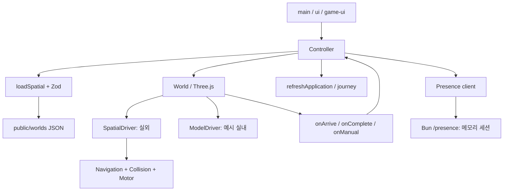

# 한바퀴 Codex V5 · 작업 이력과 AI 인계 가이드

작성일: 2026-10-12 KST. 대상은 `flykimjiwon/aptHanimo`의 **`codex/` 앱**이다. 이번 세션은 기존 V5를 인수해 전체 검수하고, 재현한 결함 5건을 수정·검증·커밋·푸시했다. 이 문서는 다음 AI가 같은 조사를 반복하지 않고 코드와 증거를 찾아 이어서 작업하기 위한 정본이다.

**소스·검증 기준:** `ed3a1ca2e77b7c24f5c83210d60b6d35651f7709`. 가이드 작성 직전 로컬 `main`과 GitHub `main`이 이 SHA로 일치했고 제품 작업 폴더는 clean이었다. 이 가이드와 README 갱신은 그 이후의 문서 변경이다. 다음 세션의 실제 HEAD는 Git으로 다시 확인한다.

## 1. 먼저 알아야 할 상태

- 기존 V5 기능은 실제로 실행된다. 세 단지, 네 이동 방식, 그림체 선택, 수첩, WebSocket 접속자 표시가 있다.
- 이번에 고친 것은 도착 UI, 자동차 경로와 완주, 지도 POI 선택 시 순간이동 취소, 모바일 배치, 초기화 오류 구분과 재시도다.
- 수정 후 **81테스트 / 3,282 assertions / 18파일**, 타입 검사·빌드 통과. 실제 공간 데이터의 **80경로 생성·완주**, 브라우저 자동차 **17목적지**, 화면 **8조건**을 확인했다.
- 실제 iOS/Android 기기, 모든 스타일 조합, 장시간 부하, 공개 배포까지 검증한 것은 아니다. 현재는 로컬 실행 가능한 프로토타입이다.
- 후속 우선순위는 브라우저 회귀 자동화, 실제 출입구·통행 데이터, 실제 모바일 검증이다. 새 기능 후보는 단지 비교와 수첩 재방문·동기화다.

### 서로 다른 두 앱

| 경로 | 구현 | 이 세션과의 관계 |
|---|---|---|
| `codex/` | TypeScript + Vite + Three.js + Bun, 한바퀴 V5 | 이번 검수·수정 대상 |
| `prototype/` | Claude의 Canvas 2D 프로토타입, 현재 V8 | 다른 세션의 변경을 보존했으며 이번 Codex 수정에 섞지 않음 |
| 저장소 루트의 기획서·카탈로그 | 초기 기획과 다른 구현의 참고 자료 | 현재 Codex 기능은 실제 코드와 이 가이드로 판정 |

`prototype/CODEX_PROTOTYPE_GUIDE_2026-10-11.md`는 파일명에 Codex가 있어도 `prototype/` 안내다. Claude V8의 일방통행 처리·149건 테스트를 Codex의 기능·테스트 수에 합치지 않는다. Codex의 현재 공간 경로 스키마에는 일방통행 방향 필드가 없다.

### 권장 읽기 순서

1. 이 문서: 현재 상태, 수정 이유, 재현 방법, 다음 작업.
2. [앱 README](../README.md), [디자인 계약](../DESIGN.md).
3. [이번 수정 검증](../qa/v5/repair-2026-10-12.md), [QA 인덱스](../qa/v5/QA.md).
4. [기존 V5 제작·출처 가이드](Claude_V5_전체월드스타일_구현가이드.md).
5. 아래 §8의 부모 저장소 검수·수정 보고서와 원본 증거.

과거 문서의 `NEEDS_WORK`, `UNCOMMITTED`, 브라우저 권한 대기 문구는 작성 당시 상태다. 이번 5건의 최종 판정은 후속 수정 보고서를 따른다. 과거 증거를 현재 결과로 덮어쓰지 않는다.

## 2. 인수부터 푸시까지 실제 한 일

| 단계 | 수행 내용 | 결과 |
|---|---|---|
| 저장소 확인 | 기존 로컬 clone·원격·브랜치 확인, `git pull --ff-only origin main` | 당시 `1ff68d5`, 이미 최신. 새 clone은 필요 없었음 |
| 실행 준비 | frozen install, 테스트·타입 검사·빌드·lint, HTTP/gzip·WebSocket 2클라이언트 확인 | 최초 74테스트·2,861 assertions·17파일 통과 |
| 전체 검수 | 실제 Ego Chromium으로 3월드, 35개 스타일 개별 선택, 7프리셋, 수첩 CRUD/내보내기, 도감, 접속자, 실내외, 키보드·터치 확인 | F1–F5 재현, 자동차 경로 10건 실패 발견 |
| 구현 | 이동 엔진, 완료 이벤트, 공통 선택 경계, 모바일 설정 배치, 오류 복구 수정 | 코드와 필요한 회귀 테스트 추가 |
| 후속 검증 | 80경로 엔진 주행, 자동차 17목적지, 대표 3주행, 8화면 조건, 3종 오류 복구, axe·터치 확인 | 아래 §7의 범위에서 통과 |
| 정리·발행 | 테스트용 저장값 복원, 오류 주입 해제, QA 페이지 종료, 제품 3커밋 푸시, 부모 보고·원장 보존 | GitHub `main` SHA 직접 대조 |
| 이번 문서화 | 이 가이드, README의 오래된 QA 상태 정정, 부모 참조 문서·색인 | 앱 로직 추가 변경 없음 |

초기 사용자가 알려준 마지막 시각은 **2026-10-12 00:30 KST = 2026-10-11 15:30 UTC**다. 당시에는 3커밋이 전부였지만 아래 후속 커밋들이 추가됐다.

| 커밋 | 내용 | 구분 |
|---|---|---|
| `055d06c` | 기획서·Claude prototype V6·스타일 랩·25구 카탈로그 | 인수 이전 |
| `64e2b49` | Codex 한바퀴 V5 자유 산책 월드 | 인수 이전 |
| `1ff68d5` | Codex V5 제작 가이드·출처·검증 기록 | 이번 인수 기준 |
| `f7da8c1` | Claude prototype V7 검수 수정 | 다른 세션 |
| `bd240cc` | Claude prototype V8 OSM 재굽기·일방통행·149테스트 | 다른 세션 |
| `b0082aa` | Codex 차량 경로 완주·도착 상태 갱신 | 이번 구현 1 |
| `e5c1767` | Codex 모바일 조작부·순간이동 취소·로딩 재시도 | 이번 구현 2 |
| `ed3a1ca` | Codex 후속 테스트·브라우저 검증 기록 | 이번 검증 문서 |

이번 발행의 전체 SHA:

- 이동 수정: `b0082aa1827b1a2ea437541c58f320de3ddbce43`
- 조작부·복구: `e5c1767b3ab3c32672aa7d5bb93939aa8fe14181`
- 검증 기록: `ed3a1ca2e77b7c24f5c83210d60b6d35651f7709`
- 부모 보고·증거 발행: `00d7955b729ed76389059ac367ed1e9435f315f9` (`flykimjiwon/kimjiwon`, 다른 문서와 함께 발행됨)
- 부모의 제품 푸시 영수증: `ca4112d8084e8c4495293dd461f33622f7d87847`

위 항목은 모두 `main`에 푸시 후 원격 SHA를 확인했다. PR 생성이나 공개 서비스 배포는 하지 않았다.

## 3. 실행과 점검

### 이 워크스페이스에서 시작

```sh
cd ~/Desktop/kimjiwon
cd my-projects/aptHanimo
git status --short
git branch --show-current
git log -8 --oneline
git ls-remote origin refs/heads/main
```

이 워크스페이스는 nested repo 구조다. 제품 Git 작업은 `aptHanimo/`, 보고·원장은 부모 `kimjiwon/`에서 한다. 상위 `AGENTS.md`와 대상 repo의 새 지침을 먼저 확인한다. 다른 세션의 dirty가 있으면 범위를 확인하고 보존한다. 원격과 차이가 있을 때 기존 변경을 덮어쓰지 않고 fast-forward 가능 여부를 확인한다.

### 앱 실행

```sh
cd ~/Desktop/kimjiwon/my-projects/aptHanimo/codex
bun install --frozen-lockfile
bun run build
bun start
```

- 본편: `http://localhost:5178/`
- 직접 단지 선택: `/?complex=haiver`, `/?complex=xi`, `/?complex=cherbo`
- 스타일 실험실: `http://localhost:5178/style-lab.html`
- 같은 Wi-Fi 휴대폰: 실행 컴퓨터의 LAN IP와 `:5178`.

검증 당시 Bun은 `1.3.14`였다. 의존성은 `bun.lock`을 기준으로 설치한다. 생성된 월드 JSON과 앱 자산이 포함돼 있어 기본 실행에 별도 API 키나 `.env`는 필요 없다. 수집 스크립트 재실행에는 외부 자료/API 접근이 필요할 수 있다.

`bun start`는 `dist/`와 `/presence` WebSocket을 함께 제공한다. `bun run dev`는 Vite UI 개발 서버이며 WebSocket 서버를 함께 띄우지 않는다. Vite 포트는 실행 로그를 확인한다. 빌드 진입점은 [vite.config.js](../vite.config.js)의 `index.html`, `style-lab.html`이다.

문서 작성 시 기존 5178 서버의 HTTP 200을 확인했다. 다음 세션에서 서버가 살아 있다고 가정하지 않는다. 포트가 사용 중이면 프로세스와 작업 경로를 확인한 뒤 재사용한다. 프런트 수정은 재빌드 후 새로고침하고, `server.ts` 수정은 해당 서버 재시작이 필요하다.

### 회귀 명령

`codex/`에서 실행한다. 테스트는 `public/worlds/`를 작업 디렉터리 기준으로 읽는다.

```sh
bun test
bun run check
bun run build
bun run lint
git diff --check
```

`build`에도 `tsc --noEmit`이 포함된다. 이동 관련 집중 검사:

```sh
bun test src/scene/navigation.test.ts src/scene/segment-clearance.test.ts src/scene/world-step.test.ts
```

부모 수정 보고 폴더의 `route-probe.mjs`는 4모드 × 전체 20개 POI를 주행하며 같은 폴더의 `route-probe.json`을 **덮어쓴다**. 재검증 때는 `docs/analysis/` 아래 새 날짜·작업 폴더로 스크립트를 복사해 동일한 상대 경로 깊이에서 실행하고 결과를 새 증거로 보존한다. 이전 실패·성공 기록을 덮어쓰지 않는다.

## 4. 현재 기능과 데이터의 정확한 범위

| 항목 | 현재 구현 | 해석상의 경계 |
|---|---|---|
| 플레이 월드 | 하이베르 `haiver`, 왕십리자이 `xi`, 라체르보 `cherbo` | 3개만 플레이 가능 |
| 공간 | 실제 좌표·건물 외곽선·OSM 길·DEM, 단지 중심 약 1.3km 정사각 범위 | 측량·차량 통행 허가·최단경로 보장 아님 |
| 코어 건물 | 15 / 7 / 7동 | 주변 건물도 별도 포함, 총 건물 수와 구분 |
| 실외 POI | 7 / 6 / 7개, 각 `home` 포함 총 20개 | `placesFor()` 목록 중 실제 월드 POI에 없는 실외 장소는 필터됨 |
| 이동 | 도보·유모차·자전거·자동차, 키보드·터치·탭 안내 | 경사·출입구·통행 제한 검증은 미완료 |
| 시간·카메라 | 1/2/4/8/16배속, 기본 2배, 줌·핀치·따라가기 | 속도와 줌은 독립 |
| 본편 스타일 | 캐릭터 10, 건물 11, 지도 11, 시점 3, 프리셋 7 | 개별 선택 35개를 검사했으며 전체 3,630조합 검사 아님 |
| 스타일 실험실 | Canvas 2D 카드 30개, 각 범주 10개 | 본편 선택 수와 다른 비교용 화면 |
| 실내 | 커뮤니티·지하 주차장 | 실제 도면 없는 구조 예시 |
| 수첩 | 로컬 저장, 삭제, Markdown 내보내기 | 계정·서버 동기화 없음 |
| 접속자 | 같은 서버·단지·방의 실제 WS 접속자 | 커플/가족은 한 사용자의 동행 연출 |
| 도감 | 서울 25구 공개 데이터 2,893레코드 | 서울 모든 법적 단지의 완전목록이나 2,893월드가 아님 |
| 주간 관심 | 2026-09-28~10-04 자료 250건 | 실시간 인기순위 아님 |
| 광고 | 데모 표시 | 광고망·과금·추적 미연결 |

좌표 규약은 **1단위 = 1m, 동쪽 +X, 남쪽 +Z**다. 높이는 월드 원점 기준으로 렌더한다. DEM은 SRTM 30m 원자료를 65×65로 쌍선형 재표본화한 것이며 약 20.3m 렌더 격자를 더 정밀한 실측값으로 설명하지 않는다. 현재 수집 구현은 Mapzen/Tilezen Terrarium 타일을 사용한다. 오래된 설명의 고도 제공자 이름만 믿지 말고 코드·생성 JSON의 출처를 함께 확인한다.

공간 원천은 `public/worlds/*.json`, 부가 데이터는 `public/data/`와 연구 문서를 따른다. `research/spatial/QUALITY.md`, `research/spatial/V5_CONTEXT.md`, `research/brands/README.md`에 품질·관찰 근거가 있다. 사진 36장은 기존 제작 관찰 자료이며 이번 수정 세션에서 다시 수집·전수 검증한 것이 아니다.

수집·정규화 도구는 `scripts/collect-spatial.mjs`, `collect-context.mjs`, `prepare-catalog.mjs`, `prepare-trends.mjs`다. 사진 원본·지도 캡처·임시 API 응답은 Git에 모두 포함되지 않는다. `prepare-catalog.mjs`에는 조사일 `2026-10-11`이 고정돼 있으므로 새 자료를 수집하면 날짜·해시·범위를 함께 갱신해야 한다. OSM 등 출처와 권리 고지를 유지한다.

## 5. 코드 지도와 실행 흐름



| 파일/영역 (`codex/` 기준) | 책임과 수정할 때의 주의점 |
|---|---|
| `src/main.ts` | shell 생성, 버튼 이벤트, 스타일·속도·수첩 연결, 순간이동 선택 훅, 초기화 재시도 |
| `src/controller.ts` | 단지·선택 장소·이동 모드·층 상태, World/Presence 수명, 비동기 요청 번호, UI 갱신 |
| `src/application-ui.ts`, `src/ui.ts` | 경로·현재 위치로 안내 카드 상태 도출, 목록·버튼·문구 갱신 |
| `src/game-ui.ts`, `src/game.css` | 월드 HUD·설정 그룹·반응형 배치. CSS 로드는 style → responsive → game 순서 |
| `src/map-teleport.ts` | 지도 시작 위치 선택의 대기·취소·ground 클릭 처리 |
| `src/scene/world.ts`, `world-frame.ts`, `world-step.ts` | 렌더러·카메라·입력·물리 업데이트·완료 이벤트·정리 연결 |
| `src/scene/spatial-driver.ts` | 실외 경로 계획, 자동 이동, 복구, 실제 도착/인근 완료/중단 구분 |
| `src/scene/navigation.ts`, `navigation-grid.ts` | A* 탐색·경로 단순화·2m 격자·차량 탐색점 투영·캐시 |
| `src/scene/spatial-collision.ts`, `segment-clearance.ts` | 이동 반경을 포함한 건물·도로·계단 판정, 차량 선분 전체의 통과 가능성 |
| `src/scene/motor.ts` | 수동 가속·회전·충돌 이동, 자동 안내 선분을 따라가는 이동 |
| `src/spatial/load.ts`, `types.ts`, `height.ts` | JSON 요청·Zod 스키마·공간 타입·고도 보간 |
| `src/world-errors.ts`, `world-loading.ts` | typed 오류 원인과 로딩/실패/재시도 UI |
| `src/world-hud.ts` | 250ms HUD 갱신 타이머. 생성과 정리를 짝지어야 함 |
| `src/scene/scene-renderer.ts` | WebGL 렌더러 생성 실패의 오류 경계 |
| `src/complexes.ts`, `data.ts`, `graph.ts` | 단지·장소 메타와 예시 실내 그래프. 실외는 공간 JSON 기반 |
| `src/world-style*.ts`, `src/scene/`의 표현 모듈 | 스타일 검증·저장·URL·아바타·건물·지도·카메라 표현 |
| `src/notebook.ts`, `storage.ts`, `catalog.ts` | 수첩과 공개 도감 UI |
| `src/presence.ts`, `protocol.ts`, `server.ts` | 위치 메시지·방·연결 상태·메모리 세션·정적 파일 제공 |

서버는 단일 Bun 프로세스다. 현재 제한은 방당 16명, 전체 64세션, IP당 16세션, 메시지 최대 2KB, 수신 간격 50ms다. 서버 재시작 시 세션은 사라진다. 이 값은 코드상의 제한이며 해당 규모의 장시간 부하 테스트 결과가 아니다.

기술스택은 vanilla TypeScript, Vite, Three.js, Bun, Zod, ky, Lucide다. Next.js·Supabase 연결은 아직 없다. 과거 확장안만 보고 전체 앱을 먼저 이식하지 말고 현재 구조에서 필요한 기능의 경계를 정한다.

## 6. 수정한 5건: 원인 → 변경 → 유지할 계약

### F1. 인근 길에 도착해도 안내가 진행 중으로 남음

하이베르에서 성동고로 이동하면 실제 POI와 약 63m 떨어진 접근 가능한 길 끝에서 멈추지만 안내 카드에는 이동 중 상태가 남았다. `SpatialDriver`가 반환한 일반 `complete`를 `world-step.ts`가 UI에 전달하지 않은 것이 원인이었다.

`onComplete(blocked)`를 World 이벤트까지 연결해 `Controller.refresh()`와 상태 문구를 갱신한다. 이름 있는 목적지의 `arrived`는 기존 경로를 유지한다. 복구를 포기한 경우는 `complete`가 아닌 `blocked`로 전달한다. 이름 없는 종점을 이전 `home`이나 선택 POI의 실제 도착으로 꾸미지 않는다.

회귀는 `world-step.test.ts`의 성동고 접근 완료와 기존 일반 지점·이름 있는 목적지 테스트다. 실제 화면에서 “인근 길에 도착”과 수첩 동작으로 전환하는 것을 확인했다.

### F2. 자동차 10경로 실패와 자동 주행 이탈

초기 80사례 중 10개가 경로를 만들지 못했다. 모두 자동차이며 비출발점 17개 중 하이베르 4·자이 5·라체르보 1개였다. 2m 격자가 좁은 대각선 도로를 끊어 탐색하는 문제에, 차량 회전 관성·코너 건너뛰기·샘플 사이 충돌 누락이 겹쳤다.

최종 변경은 다음과 같다.

1. **2m 격자는 유지**한다. 막힌 차량 탐색점만 최대 셀 반대각선 범위인 약 1.414m 안에서 통과 가능한 도로 중심선으로 투영한다.
2. 차량의 탐색 연결·지름길·출발점/종점 연결을 선분 전체로 검사한다. 도로 폭에서 차량 반경을 뺀 통로들의 합집합이 선분을 연속으로 덮는지, 건물에서 충분히 떨어지는지 확인한다.
3. 자동 주행은 안내 선분의 방향으로 이동하고 남은 거리를 넘지 않는다. waypoint 완료 임계값을 0.65m에서 0.01m로 줄여 코너를 잘라 지나가지 않는다. 수동 운전의 회전 조작은 유지한다.

중간에 1m·0.5m·0.25m 격자 실험을 했지만 최종 설계가 아니다. 격자를 촘촘하게 하는 것만으로 비용과 주행 문제가 해결되지 않았다. 도로 폭을 늘리거나 차량 반경을 줄이는 수정도 하지 않았다.

회귀는 `navigation.test.ts`의 3단지 자동차 전체 POI 계획·주행과 `segment-clearance.test.ts`의 작은 도로 틈, 연결 통로, 건물 가장자리다. 추가 80사례 엔진 실행에서 중단 0, 불가 위치 0, 종점 오차 1m 미만을 확인했다. 이 결과를 실제 도로의 접근 허가나 최적 경로 인증으로 해석하지 않는다.

### F3. 지도 라벨 선택 후 순간이동 대기가 남음

문서의 `data-place` 버튼 처리에서는 순간이동을 취소했으나, 지도 라벨은 `Controller.selectPlace()`를 직접 호출해 취소 경계를 건너뛰었다. 공통 선택 함수의 `onSelectPlace` 훅을 `mapTeleport.cancel`에 연결했다.

새로운 장소 선택 UI도 공통 선택 함수를 사용한다. 브라우저에서 순간이동 대기 → 지도 POI 클릭 → 대기 안내 숨김·목적지 변경을 확인했다.

### F4. 모바일·태블릿 조작부 겹침

390px에서 기존 도구·층 버튼이 30×54px 겹쳤고 일부 버튼이 24~39px였다. 공통 `.world-settings`를 만들고 1100px 이하에서 설정을 그리드로 배치했다. 휴대폰 카메라 버튼은 가로 배치, 주요 설정은 44px 확보, 태블릿 하단 미니맵·조이스틱·안내문 간격도 조정했다.

1440×1000, 768×1024, 390×844, 375×667에서 두 OS 색상 선호를 검사했다. 측정 대상 주요 조작부 겹침·44px 미만·문서 가로 넘침은 모두 0이었다. 모든 DOM 요소나 실제 모든 휴대폰을 검사했다는 뜻은 아니다.

### F5. 데이터 오류를 WebGL 오류로 오진하고 재시도할 수 없음

초기화 실패를 모두 그래픽 문제로 설명하던 것을 `SpatialLoadError(network|invalid)`와 `GraphicsUnavailableError`로 구분했다. 다시 시도 버튼이 `initialize()`를 호출한다. 기존 요청 번호 검사를 유지하고 실패 시 타이머·Presence·World를 정리한다. World 정리 시 렌더러 canvas도 제거한다.

로딩·오류 중 월드 조작부가 안내를 가리지 않도록 숨기며 헤더·단지 정보·수첩은 계속 이용할 수 있다. 실외 경로 없음에 실내 예시 문구를 보이던 분기도 수정했다. 새 오류 UI는 **초기화 실패**에 적용되며 이미 열린 월드의 단지 전환 실패는 기존 toast 흐름이다.

네트워크 차단, 정상 HTTP 응답의 잘못된 JSON 구조, WebGL context 생성 실패를 각각 주입하고 원인을 구분하는 문구·버튼 재시도·복구 후 canvas 1개를 확인했다. `worldUnavailable()`의 예상 오류 콘솔 기록까지 “콘솔 오류 0”으로 설명하지 않는다.

## 7. 검증 범위와 재현 체크리스트

### 이미 완료한 검증

| 검사 | 최종 결과 |
|---|---|
| Bun 테스트 | 81 pass / 0 fail, 3,282 assertions, 18파일 |
| 타입·production build | 통과, gzip 26개 |
| Biome | 종료 0, 오류 0, 기존 경고 26·정보 59 |
| 실제 데이터 엔진 경로 | (하이베르 7 + 자이 6 + 라체르보 7 POI) × 4모드 = 80/80 생성·완주 |
| 엔진 주행 판정 | 중단 0·불가 위치 0·종점 오차 모두 1m 미만, 한 실행의 최대 계획 시간 209ms |
| 브라우저 차량 UI | 비출발점 17/17 안내 가능, 자이 `station`·하이베르 `park`·라체르보 `park` 16배속 완주 |
| 레이아웃 | 4화면 크기 × light/dark 선호 = 8조건 통과 |
| 오류 복구 | 네트워크·스키마·WebGL 각각 재시도 후 정상, canvas 1개 |
| 터치 | Chromium CDP 조이스틱 이동 1m 이상, release 후 값 0 |
| 자동 접근성 | axe 390px·1440px WCAG A/AA 위반 0 |

최종 소스 지문은 `ebebcb81094ac83c604377ed16656bd47911a5256193e75e00b07a942fd9249d`다. 검사 대상 소스·설정·월드 132파일과 해시는 부모 수정 보고의 `source-manifest.json`에 있다. 커밋 직전에도 모두 일치했다. 문서에 적힌 숫자는 이 코드 기준의 당시 결과이며 미래 실행 결과로 재사용하지 않는다.

### 다음 UI 수정 때 재현할 핵심 시나리오

1. 세 단지의 첫 로딩, 단지 전환, 도보·유모차·자전거·차량, 지상·커뮤니티·주차장 전환.
2. 하이베르 성동고 접근 길 완료 후 이동 중 표시가 끝나는지, 실제 목적지 도착과 인근 길 도착이 구분되는지.
3. 순간이동을 준비한 뒤 지도 POI와 목록을 각각 선택해 대기가 취소되는지.
4. 17개 차량 목적지에서 안내가 가능한지와 대표 3경로의 실제 완주. 자동 안내만 검사하지 말고 수동 입력으로 중단·전환도 확인.
5. 네 화면 크기에서 설정·지도·조이스틱·상태 안내 충돌, 가로 넘침, 모달 열기/닫기, 문서 끝 접근.
6. 새 페이지 초기화 전에 `worlds/*.json` 요청 차단 → 실패 안내 → 차단 해제 → 다시 시도. 별도로 HTTP 200의 `{}` 응답, WebGL `getContext` 실패를 주입하고 복구 확인.
7. 필요 시 두 클라이언트로 같은 방·다른 방·단지 전환·종료·재접속을 검사. 새 세션 수치를 가짜 동행 인원과 혼동하지 않음.

### 브라우저 작업에서 배운 점

- 시간에 따른 주행 테스트는 해당 페이지를 전면에 둔다. 다른 오류 테스트 탭으로 이동하면 렌더 루프가 멈춰 잘못된 timeout으로 판정할 수 있다.
- HUD는 250ms마다 갱신된다. 이벤트 직후 한 프레임의 수치만 보고 실패를 판정하지 않는다.
- CDP의 viewport·touch·색상 에뮬레이션이 도구 호출 사이 유지되는지 확인하고, 실측·캡처와 같은 실행 단위에서 설정한다.
- `[hidden]` 요소를 기본 visible 조건의 `waitForSelector`로 기다리면 timeout이 난다. 로딩 완료는 해당 요소의 `hidden` 속성을 검사한다.
- 본편의 OS dark 선호와 월드의 밤 모드는 다르다. 두 OS 선호를 확인했다고 독립 다크 테마를 구현한 것은 아니다.
- 수첩·스타일·속도 원래 값을 기록하고 테스트 후 복원한다. 키는 `hanbakwi-notes-v1`, `hanbakwi-world-style-v1`, `hanbakwi-travel-speed-v1`이다. 원래 없던 키는 테스트 후에도 없도록 한다.
- 오류 주입·요청 차단·임시 후크를 해제하고 만든 QA 페이지를 정리한다. 실제 사용자 탭·저장값은 보존한다.

이번 QA는 자체 검토와 실제 Chromium 조작의 조합이다. 독립 검토자 승인, 수동 스크린리더 인증, 실제 iOS/Android, 모든 스타일 조합, Lighthouse, 장시간 메모리·동시접속 부하, 공개 배포 검증은 수행하지 않았다. 최초 핀치 100→171% 확인에는 직전 감속이 있어 캐릭터 이동 0까지 입증한 자료로 쓰지 않는다.

기존 Zod pure-annotation 경고와 world 청크 625.42kB 경고가 남아 있다. 별도 스킬 검사기는 TypeScript 7 전용 API를 요구해 프로젝트 TypeScript 5.9에서 실행되지 않았다. 프로젝트의 tsc·Biome로 검사했으며 그 검사기를 위해 TypeScript를 바꾸지 않았다.

## 8. 증거와 보고서 위치

제품 저장소만 clone한 AI도 GitHub 링크로 부모 보고를 찾을 수 있다. 접근에는 해당 저장소 읽기 권한이 필요할 수 있다.

| 자료 | 위치와 용도 |
|---|---|
| 최초 검수 | [부모 검수 보고](https://github.com/flykimjiwon/kimjiwon/blob/main/docs/analysis/APTHANIMO_CODEX_REVIEW_2026-10-12/README.md): 수정 전 F1–F5, 스타일·수첩·접속자·모바일 증거 |
| 후속 수정 | [부모 수정 보고](https://github.com/flykimjiwon/kimjiwon/blob/main/docs/analysis/APTHANIMO_CODEX_FIX_2026-10-12/README.md): 수정 결과·코드 검토·PNG/JSON 링크 |
| 작업 원장 | [TASK_REPOSITORY_LEDGER.md](https://github.com/flykimjiwon/kimjiwon/blob/main/docs/operations/TASK_REPOSITORY_LEDGER.md): READY / REVIEW / FIX / HANDOFF 이력과 발행 상태 |
| 제품 안의 검증 요약 | [repair-2026-10-12.md](../qa/v5/repair-2026-10-12.md): 제품 SHA·검사 결과·잔여 한계 |
| 데이터 품질 | [공간 품질](../research/spatial/QUALITY.md), [공원·철도](../research/spatial/V5_CONTEXT.md), [브랜드 관찰](../research/brands/README.md) |

로컬 부모 경로는 `~/Desktop/kimjiwon/docs/analysis/`다. 후속 수정 폴더의 핵심 파일:

- `route-probe.mjs`, `route-probe.json`: 80경로 주행 재현과 결과.
- `browser-car-matrix.json`: 자동차 17목적지 UI 검사.
- `layout-matrix.json`, `layout-*-*.png`: 8화면 조건 실측·캡처.
- `approach-completed.*`, `teleport-cancelled-by-map-poi.*`: F1·F3 화면/상태.
- `car-complete-{xi,haiver,cherbo}.*`: 대표 차량 주행.
- `data-*`, `invalid-data-*`, `graphics-*`: 실패·복구 증거.
- `axe-390.json`, `axe-1440.json`: 자동 접근성 결과.
- `source-manifest.json`, `audit-manifest.json`: 소스·증거 파일의 SHA-256.
- `debug-journal.md`, `storage-before.json`, `cleanup.json`: 실험 경과와 정리.

manifest의 `UNCOMMITTED @ f7da8c1...` 등은 QA 당시의 이력이다. 현재 소스 미커밋 상태를 의미하지 않는다. `errors:null`은 해당 캡처에 오류 수집 후크가 없었다는 의미이며 오류 0으로 바꾸어 읽지 않는다.

## 9. 다음 작업 후보와 완료 기준

아래는 검수 결과에 근거한 **미구현 후보**다. 이번 가이드 작성으로 구현됐거나 전체 범위가 확정된 것은 아니다. 다음 사용자 지시에 맞춰 한 묶음씩 진행한다.

| 순서 | 작업 | 시작 지점 | 완료를 판단할 기준 |
|---|---|---|---|
| 1 | 브라우저 회귀 자동화·CI | F1/F3/F4/F5 수동 시나리오, 기존 Bun 테스트 | 깨끗한 checkout에서 설치·빌드·서버 시작·3단지 핵심 흐름·375/390/768/1440 검사 재현. 실패 시 상태·화면 보존. 저장값·서버·차단 정리 |
| 2 | 실제 출입구·통행 데이터 보강 | `spatial/types.ts`, `spatial/load.ts`, 수집 스크립트, 경로 엔진 | 건물 중심/실제 입구/접근 가능한 인근 길 구분. 확인 출처·확인일·미확인 상태 기록. 계단·경사·차량 방향/접근 제한 fixture와 실제 구간 대조 |
| 3 | 실제 iOS·Android 사용성·성능 | 현재 8조건 QA와 touch 시나리오 | 실제 기기에서 조이스틱·핀치·회전·스크롤·새로고침·복구 확인, 기기/브라우저/FPS/메모리 관찰 기록 |
| 4 | 단지 비교·수첩 재방문 | `catalog.ts`, `notebook.ts`, `storage.ts`, 단지 메타 | 관심 단지 선택→비교→저장한 장소 재방문까지 완결. 조사값과 예시값, 월드 구현 여부를 화면에서 구분 |
| 5 | 계정·수첩 동기화·실제 초대 | 현재 localStorage·Presence 경계 | 소유권·오프라인·충돌·복구·내보내기와 초대/만료 흐름 결정·검증. 계정 정보와 고빈도 위치 상태 분리 |
| 6 | 데이터 갱신 재현성 | `scripts/`, 출처 manifest, 고정 조사일 | 원본 입력·생성 명령·날짜·해시·누락 원인 추적, 원자료 없는 checkout에서 가능한 범위 명시 |
| 출시 전 | 운영·배포 | `server.ts`, 메모리 세션과 고정 포트 | 목표 규모 확정 후 HTTPS/WSS·관측·재시작/롤백·권리·데이터 공개 범위 확인, 실제 배포 환경에서 검증 |

실외 `SpatialDriver`가 만드는 경로 메타의 `stairs`와 `slope`는 현재 0이다. DEM이 화면에 있다고 경사 비용이나 접근성 계산이 완성된 것이 아니다. ETA도 현재 게임 이동 모델 기준이다. 이 부분을 실제 무장애 동선으로 홍보하지 않는다.

3단지의 핵심 흐름과 정보 신뢰도를 먼저 강화하는 것이 다음 작업의 근거다. 25구 월드 일괄 생성·그림체 수 추가·프레임워크 교체는 별도 목표가 생겼을 때 결정한다.

## 10. 다음 AI가 지켜야 할 작업 경계

1. `codex/`와 `prototype/`의 코드·버전·검증 결과를 구분한다. 이전 저자의 작업을 이번 세션 성과로 합치지 않는다.
2. 좌표·DEM·도로 폭·충돌 반경을 화면 효과나 테스트 통과를 위해 임의 변경하지 않는다. 데이터 변경이 필요하면 출처와 변경 이유를 기록한다.
3. 표현 스타일이 물리 규칙·장소 좌표를 바꾸지 않게 한다. 자동 안내와 수동 운전의 계약도 분리해 유지한다.
4. 실제 도착, 인근 접근 완료, 막혀 중단, 취소를 분리한다. 새 UI는 공통 선택·완료 이벤트를 통과시킨다.
5. 초기화·단지 전환의 요청 번호와 World/Presence/타이머/canvas 정리 순서를 유지한다.
6. 저장소 값을 검사할 때 사용자의 수첩·스타일·속도를 보존한다. 새 저장 스키마에는 기존 데이터 정규화·이전 방식을 둔다.
7. 중요한 결과는 제품 문서와 부모 요약·색인·작업 원장에 남긴다. 제품 커밋을 먼저 만든 뒤 부모에 전체 SHA를 기록한다.
8. 사용자 승인 범위 안에서 해당 작업만 커밋·푸시한다. `git add .`, force push, hard reset, 기존 dirty 제거를 사용하지 않는다. 다른 세션의 변경은 경로·hunk 단위로 분리한다.

### 다음 세션에 붙여넣을 인수 문구

```text
aptHanimo의 codex/ 한바퀴 V5를 이어서 작업한다.
상위 AGENTS.md를 읽고 codex/docs/AI_HANDOFF_2026-10-12.md부터 확인해라.
이번 이전 세션의 F1~F5는 b0082aa/e5c1767에서 수정됐고 ed3a1ca에 검증 기록이 있다.
현재 Git 상태·원격·실행 서버를 새로 확인하고, 다른 세션의 dirty를 보존해라.
prototype/의 Claude V8과 codex/의 기능·테스트 수를 합치지 마라.
기준 검증은 Bun 81테스트, 엔진 80경로, 브라우저 차량 17목적지, 레이아웃 8조건이다.
이 수치를 새 변경의 검증으로 재사용하지 말고 영향 범위에 맞춰 실제 실행해라.
사용자가 지정한 후속 범위가 없으면 §9의 후보를 근거로 다음 한 묶음을 제안해라.
코드 변경 후 결과·한계·증거·커밋 SHA를 제품 문서와 부모 보고/원장에 기록해라.
```
