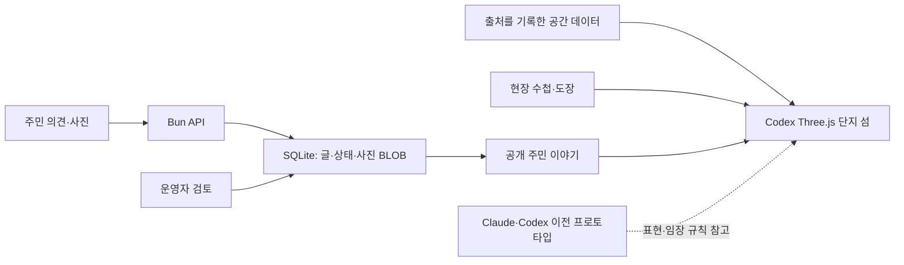

# Codex 기반 통합: 현재 기술과 다음 개발

기준: 2026-10-14, 구현 `bcce68c9a5688135dfa86b31b0c959bd66cb5a33`. 사용자는 Codex 쪽을 주력으로 선택했고, Claude와 Codex의 원본·프로토타입·제작 이력은 모두 보존한다. 이 문서가 **현재 기술 선택과 통합 방향의 정본**이다. 과거 기획서의 Phaser/React 결정과 레인별 독점 작업 규칙보다 이 결정이 우선한다.

제품은 **실제 단지를 귀여운 공중 섬으로 탐험하는 임장 도구 + 주민의 근거 있는 의견과 사진으로 갱신되는 커뮤니티**다. 하나의 주력 화면에서 개발하되, 기존 실험판은 비교 가능한 상태로 유지한다.

## 실제 설치된 기술

아래 버전은 `codex/bun.lock`과 설치된 package.json을 대조한 스냅샷이다. manifest의 `^` 범위와 실제 설치 버전은 다르다. 런타임/CI는 Bun 1.3.14다.

| 영역 | 실제 기술·버전 | 역할·위치 |
|---|---|---|
| UI | TypeScript 5.9.3, HTML/CSS, native DOM/dialog | React 없이 `codex/src/village/`, `src/community/`에서 화면 구성 |
| 입체 화면 | Three.js 0.180.0 | 주력 공중 섬, 절차적 캐릭터, 건물·지형·조명·카메라 |
| 빌드 | Vite 7.3.7 | 주력·생활권·이전 섬·스타일 랩의 독립 진입점 |
| 서버 | Bun 1.3.14, `Bun.serve`, native WebSocket | `codex/server.ts`, `src/server/`; 정적 파일·API·기존 `/presence` |
| 데이터베이스 | `bun:sqlite`, SQLite WAL | 커뮤니티 접수·검토·공개 상태·신고·사진 BLOB. ORM 없음 |
| 경계 검증 | Zod 4.6.5 | 요청·저장 데이터 계약 |
| HTTP·아이콘 | Ky 2.2.0, Lucide 0.468.0 | 클라이언트 요청·UI 아이콘 |
| 사진 | Sharp 0.35.5, 서버 전용 | 메타데이터 제거·축소·WebP 변환. 얼굴/차량번호 자동 가림은 아님 |
| 코드 검사 | Biome 2.5.15, strict TypeScript | lint·타입 검사 |
| 검증 | Bun test, 자체 HTTP/WS smoke, axe-core 4.14.0 | axe는 이미 설치됨. 브라우저 E2E CI는 후속 |
| CI | GitHub Actions: Ubuntu 24.04, Bun 1.3.14 / Node 22·Python 3.12 | Codex와 Prototype 두 job을 별도로 검사 |
| Claude 본편 | vanilla JS, Canvas 2D, HTML | `prototype/src/`를 Python 표준 라이브러리로 조립·굽기 |
| Claude 3D 랩 | Three.js 0.180.0 CDN ESM, OrbitControls | `prototype/stylelab3d/`; CDN·웹폰트 인터넷 연결 필요 |

현재 **React, Next.js, Phaser, Zustand, Tailwind, Supabase, PostGIS, Colyseus는 설치된 앱 스택이 아니다.** `IMJANG_WORLD_MASTER_2026-10-11.md` §11·D-05·부록 D의 기술 선택은 당시 계획으로 보존한다. 지금 그 계획을 구현 완료로 소개하거나, 그 문구만 보고 엔진을 되돌리지 않는다.

## 실행·모듈 지도



이는 현재 구성의 책임 구분이다. 검토된 글이 지도 형상을 자동으로 변경하는 파이프라인은 아직 없다.

```sh
cd codex
bun install --frozen-lockfile
bun run build
bun run smoke
bun start
```

기본 주소는 `http://localhost:5178/`. 저장소 루트의 `index.html`은 기획서 뷰어이고, Bun이 서비스하는 `/`는 `codex/index.html`이다. `/`에 과거 `character`, `building`, `map`, `view`, `mode`, `party`, `layer`, `room`, `legacy` 쿼리가 있으면 호환을 위해 생활권 앱을 연다(`src/entry.ts`).

| 책임 | 정본 경로 | 후속 작업 경계 |
|---|---|---|
| 주력 화면·입력 | `codex/src/village/main.ts`, `shell.ts`, `pad.ts`, CSS | 모바일 입력·설정·단지 선택 |
| 캐릭터·월드 | `village/buddy.ts`, `neighborhood.ts`, `sites.ts`; `src/island/` 공유 기반 | 기존 스타일·표정 보존, 새 GLB는 별도 스타일로 비교 |
| 이동 | `village/route.ts`, `walker.ts`, `src/spatial/` | 실제 좌표·충돌과 연출 속도를 분리 |
| 현장 기록·주민 UI | `src/community/` | 현장 체크·도장·사진 요청·공개 피드·필터 |
| 공유 커뮤니티 | `src/server/community-*.ts`, `scripts/community-moderate.ts` | SQLite·사진 처리·검토·철회. 공개 서비스 운영은 별도 |
| 원자료 수집 | `scripts/collect-spatial.mjs`, `collect-context.mjs`; `research/` | 출처·허용 범위·좌표계를 검증한 뒤 공개 데이터에 반영 |
| 정적 데이터 | `public/worlds/`, `context/`, `data/`, `brands/` | 자료 사실과 시각적 추정 구분 |
| 기존 생활권 | `src/main.ts`, `src/presence.ts` 등 | 수첩·차량·WebSocket 기능 보존 |

현재 주력에는 주민 글을 공유하는 서버가 있지만 **생활권 앱의 실시간 접속자 기능을 주력 섬에 연결한 상태는 아니다.** 로그인·실거주 인증·댓글·요청에 대한 사진 답변 연결·알림·공개 호스팅도 미완료다.

## 공간·사진·저장 계약

- Codex는 실제 좌표를 로컬 미터로 변환한다(동쪽 +X, 북쪽 −Z). 2m 탐색 격자와 선분 충돌 검사를 사용한다. 탐색 격자의 간격은 원자료 정확도가 아니다. 시각적 건물·지형 압축과 빠른 산책 연출을 실측 ETA나 유모차 통행 보장으로 쓰지 않는다.
- Codex 고도는 **Mapzen/Tilezen Terrarium 타일**을 재표본한 표시 격자다. `research/spatial/manifest.json`에 SRTM과 일부 GMTED2010 혼합 출처가 기록되어 있다. Claude의 OpenTopoData SRTM 저장본과 파이프라인이 다르다.
- 알려진 출처 결함: `collect-spatial.mjs`는 헤더 누락을 `SRTM (header unavailable)`로 대체하고 설명 일부가 SRTM 단일 출처를 가정한다. **미해결**이며 다음 자료 정리에서 unknown과 혼합 출처를 보존해야 한다. 이번 문서 작업은 원자료를 재수집하지 않았다.
- OSM 도로·건물, 고도, 수동 사실, 제3자 지도에서 확인한 단지 윤곽의 출처를 따로 유지한다. 오픈소스 라이브러리의 허용 라이선스가 지도·위성사진·단지 경계의 재배포 권한을 주지는 않는다. 기존 자료의 공개 서비스 이용 범위는 미확정이다.
- 현재 사진은 **같은 SQLite DB의 BLOB**이다. 입력 6MiB·20MP 제한, 최대 1600px WebP 변환, 저장 결과 1MiB 제한이 있다. 일관된 DB 백업에는 사진도 포함된다. 외부 object storage는 아직 없다.
- 기존 `hanbakwi-notes-v1`, `hanbakwi-world-style-v1`, `hanbakwi-village-field-v1:<complex>`, `hanbakwi-village-receipts-v1`, Claude `imjang-proto-v2`를 자동 병합·삭제하지 않는다. receipt는 작성자 철회 권한이므로 로그/분석 수집에 넣지 않는다.

## 두 구현에서 합칠 장점

| 기능 | Codex 기반에서의 판단 | Claude에서 가져올 것 | 완료 조건 |
|---|---|---|---|
| 실제 단지 공중 섬 | **주력 유지** | 단지 중심 구성·단순한 스타일 실험 | 세 단지와 기존 진입점 유지 |
| 귀여운 캐릭터·표정 | **일부 통합 완료**: 비례·얼굴·피벗·상태·도착 반응 | v13의 표현 규칙; 소스를 그대로 이중 실행하지 않음 | 기존 3풍·4종·6상태 회귀, 원본 별도 보존 |
| 탭 산책·모바일 설정 | **일부 통합 완료** | 목적지 피드백·설정 접기·카메라 가림 회피 | 작은 화면·터치·키보드·재방문 확인 |
| 임장 비교·출근 구간 | **미통합** | 수단별 비교·출처 카드·주차 3분 일관성 | 새 좌표에서 계단·경사·방향·신호 자료 검증 후 계산 |
| 사실 신뢰도 | **보강 필요** | 사실/추정/주장/미확인의 구분과 정정 흐름 | 출처·관찰 시각·검토자 상태·변경 이력 표시 |
| 현장 수첩·공유 | 양쪽 구현 보존, 주력 수첩 있음 | Claude 이미지 내보내기/공유 UX | 새 수첩 형식의 내보내기·복구, 저장 실패·기존 기록 보호 |
| 주민 참여 | 주력에 접수·검토·공개·필터·철회 있음 | 임장 질문과 사실 정정 패턴 | 요청→답변 사진→검수→월드 반영 이력 연결 |
| 성능 | 현재 렌더 수요 관리·60Hz 제한·숨김 정지 유지 | 지연 생성·반복 할당 제거의 원칙 | 실제 기기의 프레임·메모리·발열 측정 |
| 회귀 검증 | Bun·서버 테스트 유지 | 149개 이동 규칙·11개 검증기 테스트와 재굽기 | 서로 다른 골든값·검사 수를 합산하지 않음 |

Claude의 25m 타일·8m 단계 높이와 Codex의 연속 좌표를 섞지 않는다. Claude의 11/19/8분은 해당 모델의 회귀값이며 새 엔진의 정답이 아니다. v13 JSON 내보내기는 선택을 전달하는 자료이며 주력 자동 import가 구현됐다는 뜻이 아니다.

## 다음 개발 순서와 인수 조건

1. **자료 신뢰성**: DEM 출처 결함을 수정하고 `source / observedAt / confidence / status`를 정규화한다. 출처 없는 정보를 자동으로 사실 승격하지 않는다. 공공 건물 자료는 한 단지의 실제 응답·CRS·hole·ID·허용 범위를 확인한 뒤 어댑터를 만든다.
2. **사진 요청에 답하기**: 요청 ID와 답변·사진을 연결하고 검토 전 비공개, 승인 후 공개, 철회·신고·중복 재시도 규칙을 검증한다. 완료 상태가 실제 데이터 변경 기록과 연결되어야 한다. 별도 대형 포럼 도입 없이 현재 서버로 시작할 수 있다.
3. **복구·모바일 E2E**: SQLite를 일관되게 백업하고 새 디렉터리의 서버로 복구해 글·사진·상태를 읽는다. 모바일 제출/실패/재시도/검토 전후 흐름을 브라우저 CI로 만든다. 실제 iOS·Android 기기 검증은 에뮬레이션과 별도로 기록한다.
4. **대표 캐릭터 1종**: 현재 절차적 캐릭터를 유지하고 원본 모델 1종을 Blender 또는 Blockbench로 제작한다. 자신의 리그에 6상태를 만들고 Three 0.180에서 크기·표정·피벗·재질·해제를 검사한 뒤 별도 스타일로 추가한다. 압축은 그 다음이다.
5. **주변 장단점·비교**: 장소·시간·근거를 붙인 관찰 카드와 비교 UI를 이식한다. 검증된 계단/경사/일방통행 입력 없이 실제 소요시간을 약속하지 않는다.
6. **운영 확장**: 계정/알림/외부 스토리지/멀티플레이는 이용량과 제품 요구에 따라 선택한다. 새 프레임워크 전환을 통합의 선행 조건으로 만들지 않는다.

오픈소스별 채택 조건과 제외 사유는 [조사 카탈로그](OPEN_SOURCE_RESEARCH_2026-10-14.md)에 있다. 후보 나열은 설치 완료를 뜻하지 않는다.

## 보존과 검증

[프로토타입 보존 목록](PROTOTYPE_ARCHIVE_2026-10-14.md)에서 원본·생성물·진입점을 확인한다. 주력 변경은 `codex/src/village/`와 공유 모듈에 한정해 설계하고, 실험판을 정리 명목으로 삭제·덮어쓰기하지 않는다. AI별 폴더 독점 대신 작업마다 파일 책임을 나눈다.

현재 코드 기준 직전 검증은 Codex 150테스트·12,492 assertions·26파일, HTTP 64·WS 6, Prototype 규칙149·검증기11이다. [기준 SHA의 CI](https://github.com/flykimjiwon/aptHanimo/actions/runs/38499138048)는 두 job 통과다. 이 문서 추가가 새 UI 실기 검증을 의미하지 않는다.

```sh
cd codex
bun test
bun run build
bun run smoke
bun run lint
```

Prototype의 정본·재생성 절차는 [검증 가이드](../prototype/tests/README.md)를 따른다. 공개 호스팅·실기·수집 자료 사용권·복구 운영은 별도 완료 조건으로 남는다.
